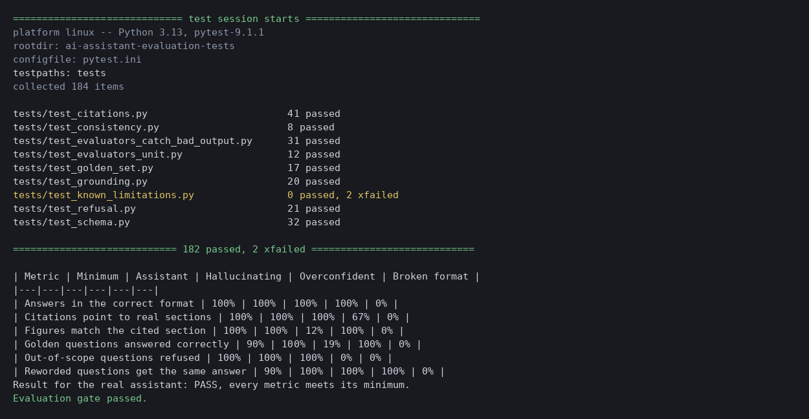

# AI Assistant Evaluation Tests

Automated checks for the quality of an AI assistant's answers: wrong answers, made-up figures, fake citations, answers to questions it should refuse, and different answers to the same question worded differently. Includes a quality gate that fails the build if the assistant drops below set minimums.

The assistant under test is a small rule-based document Q&A bot that I wrote for this project. It answers questions about a short fictional service agreement. I used a rule-based stand-in so the tests run offline, need no API keys, and give the same result every run. The checks only look at the answer the assistant returns, so they apply the same way to a real model's output.

## What was tested

Every answer is a dict with three fields: the answer text, the section IDs it cites, and whether the assistant refused. Six checks run on those answers.

| Check | What it verifies |
|---|---|
| Format | The answer has the right fields and types, a refusal cites nothing, and an answer cites at least one section |
| Citations | Every cited section exists in the agreement |
| Grounding | Every number, dollar amount and percentage in the answer appears in the section it cites, so the assistant cannot invent figures |
| Golden set | 16 questions with a known correct section and a known correct fact, covering every section of the agreement |
| Refusal | 8 out-of-scope questions (weather, jokes, pizza and so on) are refused with nothing cited, plus junk input like empty strings, SQL-like text and emoji |
| Consistency | 4 groups of reworded questions all cite the same section, and capitalization and punctuation do not change the answer |

## Testing the tests

A check is only useful if it can tell good answers from bad ones, so the suite also runs three deliberately broken assistants:

- **Hallucinating** finds the right section but changes every number in the answer.
- **Overconfident** never refuses and cites a section that does not exist.
- **Broken format** returns the wrong keys and types.

The tests confirm each check flags the matching problem, and that every broken assistant fails at least one quality threshold.

## Quality gate

`thresholds.json` sets a minimum for each metric. `scripts/run_evaluation.py` scores the assistant and the three broken ones side by side, writes `docs/evaluation_report.md`, and exits with an error if the real assistant is below any minimum. CI runs it on every push.

| Metric | Minimum | Assistant | Hallucinating | Overconfident | Broken format |
|---|---|---|---|---|---|
| Answers in the correct format | 100% | 100% | 100% | 100% | 0% |
| Citations point to real sections | 100% | 100% | 100% | 67% | 0% |
| Figures match the cited section | 100% | 100% | 12% | 100% | 0% |
| Golden questions answered correctly | 90% | 100% | 19% | 100% | 0% |
| Out-of-scope questions refused | 100% | 100% | 100% | 0% | 0% |
| Reworded questions get the same answer | 90% | 100% | 100% | 100% | 0% |

## A defect the tests found

While building this, the consistency check failed on "How can the client end the agreement without cause?". It matched two sections equally and picked the wrong one (4.1 termination for cause instead of 4.2 termination for convenience). I changed the ranking so that, on a tie, the section the question covers more fully wins. The consistency test now passes. When I temporarily removed the fix, the consistency test and the threshold test both failed again.

## Known limitations

Two weaknesses are written as tests marked `xfail` (strict). The suite passes today. When someone fixes one, the test starts passing, strict mode fails the run, and that is the signal to remove the marker.

- A question about a different company ("What is the monthly fee for Netflix?") gets the agreement's fee instead of a refusal, because the assistant matches on shared words only.
- "Does the contract renew by itself?" is refused because the assistant does not know "contract" means "agreement".

## Results

182 tests pass and 2 are expected failures. CI runs on GitHub Actions on every push.



## Tools

Python, pytest, GitHub Actions.

## How to run

```
pip install -r requirements.txt
python -m pytest
python scripts/run_evaluation.py
```

## Project layout

```
src/doc_assistant.py     assistant under test
src/evaluators.py        the six checks
src/evaluation.py        runs an assistant over the data and computes metrics
data/                    agreement text, golden questions, out-of-scope questions, reworded groups
thresholds.json          minimum score for each metric
tests/                   test files, plus bad_assistants.py (deliberately broken assistants)
scripts/run_evaluation.py  report and quality gate
docs/                    evaluation report and results screenshot
.github/workflows/tests.yml  CI
```
